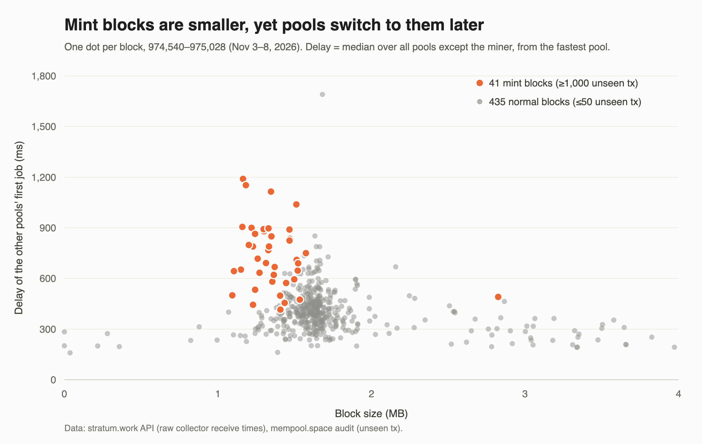

# mint-switch-delay

Data and scripts behind [bnoc.xyz/t/198/13](https://bnoc.xyz/t/198/13): how much later pools put out their
first job on top of blocks full of transactions the network hadn't seen (the UNCOMMON•GOODS P2A mint wave,
Nov 3–8, 2026), compared with normal blocks.

- `data/blocks/` – one JSON file per block, 974,540–975,028 (488 blocks)
- `analyze.py` – reproduces every number in the post (`python3 analyze.py`, or `--csv` for the table)
- `mint-blocks.csv` – the 41 mint blocks, as in the post's table
- `collect.py` – fetches more blocks from the public APIs (`python3 collect.py <from> [to]`)

**Method.** For block H, jobs come from `stratum.work/api/mining-notify?height=H+1`, kept if their prevhash
is H. Each pool's first job is measured from the earliest pool, and a block's delay is the median over all
pools except the one that mined it (at least 15 pools). These are raw collector receive times without latency
correction, so they show what stratum.work's collectors see, not the pools' internal timing. Mint block:
mempool.space's audit lists 1,000 or more unseen transactions. Normal block: 50 or fewer. The 12 blocks in
between belong to neither group.

**Not in here.** The kB fetched via getblocktxn come from my own node and can't be reproduced from public
data.

Sources: [stratum.work](https://stratum.work) and [mempool.space](https://mempool.space) APIs. Scripts: MIT.
